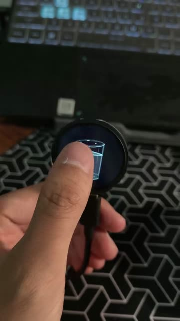

# 头文字D水杯 / Initial D Water Cup

灵感来源于《头文字D》的动态水杯。固定设备后，以当前姿态重置定位，杯中的水会随设备晃动起伏、回弹或洒出。项目用一个可交互的水杯，将驾驶控制感转化为可见的娱乐体验；它不是驾驶安全测量工具。

项目包含 ESP32-S3 圆屏固件和 Android 手机 APK。两个版本共用水面物理思路，但使用各自的渲染与运动输入适配；目前视觉效果并非逐像素相同。

## 效果展示

[](demo/water-cup-demo-muted.mp4)

上方预览为实机交互演示。播放 [静音效果视频](demo/water-cup-demo-muted.mp4)（约 22 秒）。

| 版本 | 源码 | 测试包 | 输入 |
| --- | --- | --- | --- |
| ESP32-S3 圆屏 | [`esp32/`](esp32/) | [`release/Initial-D-Water-Cup-ESP32-test.bin`](release/Initial-D-Water-Cup-ESP32-test.bin) | QMI8658 六轴 IMU、CST816S 触摸 |
| Android | [`android-app/`](android-app/) | [`release/Initial-D-Water-Cup-Android-debug.apk`](release/Initial-D-Water-Cup-Android-debug.apk) | 手机加速度计和陀螺仪；网页调试时可用鼠标 |

两个版本都保留 24 个水面节点、120 Hz 固定物理步长、恢复系数 30、阻尼 6、传播系数 40 和初始水量 0.75。Android 以 React + Capacitor 构建，**不是 Godot 工程**。

## ESP32

目标板：Waveshare ESP32-S3-Touch-LCD-1.28 **触摸版**，GC9A01A 240×240、CST816S、QMI8658、16 MB Flash、2 MB PSRAM。`esp32/` 是独立 PlatformIO 工程，不需要 Launcher 或其他本地项目。

```powershell
cd esp32
./scripts/build.ps1 -Action build
```

在 Windows 上脚本会临时映射盘符 `P:`，以兼容中文工作路径。烧录前确认串口：`esp32/platformio.ini` 目前为 `COM3`。烧录命令是 `./scripts/build.ps1 -Action upload`，会写入应用相关分区，不执行整片擦除。水杯中长按约一秒可进入补水、姿态重置与灵敏度菜单。

此仓库里的 ESP32 主程序从先前独立的 `ESP/water-cup` 工程复制；水滴后沿绘制、后倾 IMU 响应和菜单提示采用后续 Launcher 中的水杯专属更新，不含 Launcher、心跳或 BLE 模块。新目录已**独立编译成功**。此前版本的硬件显示和 IMU 交互有实机反馈；本仓库导出的 BIN 尚未重新烧录实机，因此不要把本次编译视为本次实机验证。

## Android

需要 Node.js、JDK 17、Android SDK。APK 的包名为 `com.initiald.watercup`，不会覆盖旧版 Don't Spill。

```powershell
cd android-app
npm ci
npm test
npm run build
npx cap sync android
cd android
./gradlew.bat :app:assembleDebug
```

构建产物是 `android-app/android/app/build/outputs/apk/debug/app-debug.apk`。仓库提供的 APK 为**调试签名测试包**，最低 Android API 22；正式发布需由维护者使用自己的发布密钥签名。Android 构建、APK 包名和签名已检查；新包名的手机安装、传感器方向与性能尚未经过真机验证。

`npm audit --omit=dev` 对 APK 的运行依赖报告 0 项漏洞。Capacitor 6 的构建工具链仍有开发依赖告警，未执行会破坏兼容性的跨主版本强制升级。

## 代码来源与致谢

此目录从本工作区的 `dont-spill/` 与 `ESP/water-cup/` 复制并分离；原项目没有被改动。ESP32 的 `DEV_Config.*`、`LCD_1in28.*` 和 `Debug.h` 包含 Waveshare 驱动代码，应保留原文件中的版权与许可文字。其他依赖按 `package-lock.json` 和 PlatformIO 配置安装。

项目名称仅作为同人创作标题，不代表与《头文字D》的权利人存在关联。请使用自己创作或有权使用的图像、音频与商标素材。

## 验证状态

- ESP32：PlatformIO 编译与链接成功，BIN 已生成；本次新目录固件未重新烧录。
- Android：10 项水面物理测试、TypeScript/Vite 构建和 Gradle Debug APK 构建通过；APK 的包名和 v1/v2 签名已核对；手机实测待完成。
- 原有 Launcher、心跳、硬件自检和旧版水杯工程保持原状。

项目原创代码采用 [MIT 许可证](LICENSE)。第三方代码与素材说明见 [THIRD_PARTY_NOTICES.md](THIRD_PARTY_NOTICES.md)。
